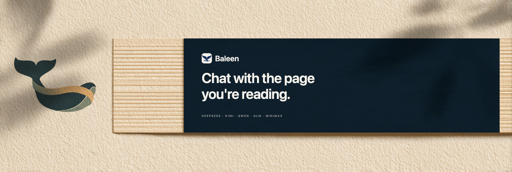

# Baleen



A Manifest V3 Chromium extension (`2.1.0`): a whale companion on every HTTP(S) page who chats about
what you highlight, summarizes the page, and compiles it into an Obsidian wiki — through your own
DeepSeek, Kimi, Qwen, GLM, or MiniMax key. Top-level PDFs open in the bundled reader with the same
selection chat.

## Companion

Ten drawings across six models.

| Model | Drawings |
| --- | --- |
| DeepSeek V4 Pro (`deepseek-v4-pro`) | Maid, moon-staff Witch |
| DeepSeek Flash (`deepseek-flash`) | notebook Maid, broom Witch |
| Kimi K3.1 Pro (`kimi-k3.1-pro`) | Pumpkin cat, Moonlit flute |
| GLM-5.3 (`glm-5.3`) | gothic Cat, Ghost poncho |
| Qwen3.8 Max (`qwen3.8-max`) | Fan gown |
| MiniMax M3 (`minimax-m3`) | Reporter |

Models with two drawings switch under **Appearance › Outfit**. No outfit adds buttons to the page.

The popup has two groups. **Appearance** sets theme, show on pages, animate, size, and outfit.
**Connection** sets the API key, model, and memory.

Each provider keeps its own key, so switching models swaps the key row. **Test** sends one tiny
request; **Get a key** opens that provider's console.

**Study** is a second level: **Wiki for Obsidian**, **Keywords**, **Summarize**, and one **Chats**
card for the reading and study transcripts. **Back** returns to settings.

Every surface writes the same settings, so a change applies to every tab and survives a reload.

Each drawing has one idle render. Listening, thinking, speaking, joy, dejection, and rest are CSS
keyframes on it, driven only by what you do; page text is never read until you send a message.
**Animate** off freezes them, and reduced-motion users get the static drawing and the bubble.

**Show on pages** hides or restores her everywhere; Alt+Shift+G (Option+Shift+G on a Mac) does the
same. Opening the popup re-injects her into tabs a reloaded extension orphaned.

Theme follows the device, or **Theme** pins Light or Dark.

## Reading chat

Click her, or focus her and press Enter: a one-line field appears above her head and Enter sends.
There is no window, thread, header, or model picker.

Her reply is one short sentence, streamed as it is written. It fades after a few seconds and is not
replayed.

Before sending, the tab is searched and only matching passages travel — about 3,500 characters. The
last six turns go too, shortened to 600 characters each, so follow-ups keep the thread.

A question that matches nothing gets an even sample of the page instead.

Click her again, press Escape, or click the page to close the bubble. The conversation belongs to
the page and survives a reload until **Clear reading chat**.

Ask how Baleen works and she answers from a short built-in reference. It travels only with questions
about the extension, and works even on a page with no readable text.

## Section chat and Study

Save a key, highlight a section, then click **Ask Baleen** at the end of the selection. The chat
floats beside the section instead of joining the page layout, and follows it as you scroll.

It opens below the selection and steps above when room is short. Drag it by its header or by any
answer; the offset survives scrolling and reloads.

Three grips resize it: the right edge for width, the bottom edge for height, the **L** corner for
both. Each grip is a button, so arrow keys work too. The size is reused by the next conversation.

**−** collapses the window to a bookmark-shaped tab in its color. Click to reopen, or drag the tab
anywhere on the page.

Each window outlines its section in its own color from a ten-color palette; the dot in the header
changes it. The color carries into the bookmark, outline, messages, and send button.

The selection itself is never altered. Close with × or Escape, or clear every window from **Study**.

Windows are remembered on the site. A reload, new tab, or restart restores the conversation, color,
position, size, and collapsed state, and the outline returns even when text renders late. Asking the
same section reopens its window.

A window starts as **New Chat** and renames itself from the first answer, falling back to the
heading. The name survives a reload.

Requests carry the selected text, the question, and image captions or alt text — never image pixels.
The window says so when a selection includes images.

Answers render Markdown and LaTeX, and thinking mode returns a collapsible **Thought for Ns** block.
Raw HTML stays literal.

## Wiki for Obsidian

The row opens a small window that lists the other tabs in this browser window. It works one step at
a time: compile, review, save.

Tick up to five pages and **Compile**. Each request carries that page's passages, your questions
about it, the memory, and the titles, aliases, summaries, and excerpts of pages already compiled for
the folder. Later pages can link to or extend earlier ones.

Every reply becomes an immutable source page with numbered passages, two to five concept pages
citing them, and a context page explaining the phrasing. The session shares one index and writes an
edit-history log.

Links and citations are checked locally before anything is written; unknown links are unwrapped and
dead citations dropped.

Choose a vault folder once and the handle is remembered. Pages land in `Baleen/<page title>/`, or
`Baleen/<first page title> +N/` for a session, so readings never overwrite each other.

Recompiling continues revision numbers and reads the folder's `index.md`. A draft on the same idea
as a listed page extends it instead of creating a duplicate.

Files you wrote, or marked `review: reviewed`, are never overwritten. Saving never deletes: pages
that fell out of the index are adopted back, and other files are reported as left in place.

A `log.md` records every compile: the topic, source revision, and pages added, updated, merged, or
kept.

When the folder is a vault root, an `obsidian://` link opens the index. No plugin, server, or extra
key is involved, and the vault is never uploaded.

## Memory and page search

She never sends a whole page. The content script splits the main region — or the PDF's per-page text
— into passages and scores them against your question with a local ranker. Bare divs are indexed
paragraph by paragraph when the semantic blocks cover less than half the region.

Only the best passages and their neighbors travel, about 3,500 characters, or an even sample when
the question is vague. The reading chat adds focus: your selection, or the section nearest
mid-screen.

**Memory** is one key-value store in `chrome.storage.local`, shared by every tab. The Connection row
shows its count; the page lists five entries at a time.

She writes an entry when you ask her to remember something, or when a chat reveals a durable
preference, interest, goal, or personal fact. Page text is never recorded.

Add a key such as `tone`, edit it, or delete it; matching is case-insensitive. Memory travels with
chats, newest first, up to about 3,000 characters.

**Obsidian vault → Save** writes `Baleen/memory.md` in the Wiki vault. **Download** and **Import**
move the list as JSON. The vault file is a copy: editing it does not change what she remembers.

Each API key sits in the same local storage and is sent only to its provider —
`https://api.deepseek.com`, `https://api.moonshot.ai`, `https://dashscope-intl.aliyuncs.com`,
`https://api.z.ai`, or `https://api.minimax.io` — when you ask.

## PDF reader

A top-level PDF opens in `viewer.html`, rendered with pdf.js. Pages draw lazily and the text layer is
selectable.

The companion and section chats work as they do on a page, and each window stays anchored through
zoom. Keywords and Summarize read the whole document; reading chat searches the per-page text.

**Download** saves the original file and **Open original** hands the URL back to Chrome once.
Attachments still download normally. Chrome's native viewer cannot host content scripts, so she does
not mount there.

The file is fetched directly from the site with its cookies and never uploaded. Only the text you
trigger is sent.

`public/pdf/` holds the worker, CMaps, fonts, WASM decoders, and ICC profiles from `pdfjs-dist`
6.4.299 (Apache-2.0, license included).

## Release notes

**2.1.0** — replies stream in as they are written. Study compiles several tabs into one wiki
session, memory moves as JSON and saves to `Baleen/memory.md`, and keys can be tested from the
popup. Earlier versions are in the commit history.

## Build

Requires Node 22.12+.

```sh
npm install
npm run typecheck
npm run build
```

Load the generated `dist/` folder from `chrome://extensions` with **Developer mode** enabled and
**Load unpacked**.

## Source

- `src/manifest.ts` — MV3 manifest: content script, storage, scripting, webRequest, site access,
  the five provider hosts, CSP.
- `src/viewer/` — bundled pdf.js reader.
- `src/popup/` — Appearance, Connection, Study, and the Memory page.
- `src/memory/` — the window that writes memory into the vault.
- `src/background.ts` — preference writes, the shortcut, tab re-injection, model requests.
- `src/shared/chat.ts` — provider client, request bodies, prompts.
- `src/shared/key.ts` — per-provider key validation.
- `src/shared/help.ts` — the built-in reference about Baleen.
- `src/shared/notes.ts` — the memory store.
- `src/shared/memoryJson.ts` — JSON import and export for memory.
- `src/content/` — companion card, section chats, reading chat.
- `src/content/retrieve.ts` — the local passage ranker.
- `src/wiki/` — the wiki tab and vault writer.
- `src/shared/wiki.ts` — the deterministic wiki compiler.
- `src/shared/` — character metadata, settings, message types.
- `public/characters/` — one WebP render per drawing.
- `public/pdf/` — pdf.js worker, CMaps, fonts, WASM decoders, ICC profiles.
- `public/icons/` — toolbar icons, rasterized from `design/baleen.svg`.
- `art-src/baleen/` — the supplied cut-outs behind the shipped renders.

## Artwork

The character renders are derivative fan art, not original work for this project.

- Character: DeepSeek 娘化 ("AI娘化") by [ZipZipPipe](https://www.pixiv.net/en/artworks/148186519)
  (Pixiv, 2026-08-09). Credit the author; no commercial use.
- All ten drawings are ZipZipPipe renders: the maid, the moon-staff and broom witches, the moonlit
  and pumpkin Kimi costumes, and the Qwen, GLM, and MiniMax sheets.
- Kimi (Moonshot AI), Qwen (Alibaba), GLM (Zhipu, Z.AI), and MiniMax are company characters. They
  are used as non-commercial fan art and imply no affiliation or endorsement.
- Original design: the whale-girl OC 溟月 by [上善](https://www.pixiv.net/en/users/62155430),
  reused under [CC BY-NC-SA 4.0](https://creativecommons.org/licenses/by-nc-sa/4.0/).
- Kept source, not bundled: the wisteria-swing drawing by 阮米糕 stays in `art-src/baleen/raw/`.
- The build keeps every condition: credit in the popup footer, non-commercial use, and share-alike
  on any redistribution of the art.

Backgrounds were removed per drawing: the maid's flat-white band and hair-loop pockets, and the
off-white pages of Flash, moonlit, pumpkin, Fan, and Reporter, keeping the shaded white of aprons,
notebooks, ruffles, gowns, coats, and socks. The GLM Cat used Leonardo's background remover because
its ground shadow survived the local key.

The broom witch and Ghost poncho arrived transparent and were trimmed directly. Every render is
trimmed and normalised to one solid-alpha height.

The toolbar icon is a separate whale-tail mark, not derived from the character art. The process is
in `art-src/baleen/WORKFLOW.md`; see `LICENSE`.
